# Architecture: Lending Commission Tracker

Nov 14, 2026 · Companion to [requirements.md](requirements.md) and [development-plan.md](development-plan.md)

The app is a static React site that talks to one Apps Script API, which is the only thing that can read or write the private Google Sheet. The browser holds no data. Every request carries a Google sign-in token, and the API checks the token, the user's role and the input before it touches the Sheet.

This document describes the **target** architecture, the state after phases 1–7 of the development plan. Today the repo has the scaffold: sign-in, the typed API client and a generic CRUD backend. Section 11 lists what still has to change.

## 1. System context

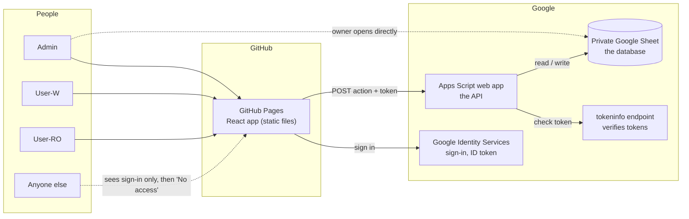

| Component | Runs on | Responsibility | Holds secrets or data? |
| --- | --- | --- | --- |
| React app | GitHub Pages (public repo) | Screens, live calculations, CSV export, sign-in button | No. Only the public Client ID and API URL. |
| Google Identity Services | Google | Signs the user in; returns an ID token valid for about 1 hour | No |
| Apps Script API | Google, runs as the owner | Verifies every request, checks role, validates, recalculates, writes under a lock, logs every change | Script Properties: `GOOGLE_CLIENT_ID`, `OWNER_EMAIL` |
| Google Sheet | Owner's Google Drive | Users, partners, transactions, shares, settings, audit log | Yes. All business data; shared with nobody. |

## 2. Life of a request

Every API call follows this path; reads and writes differ only in the last step.

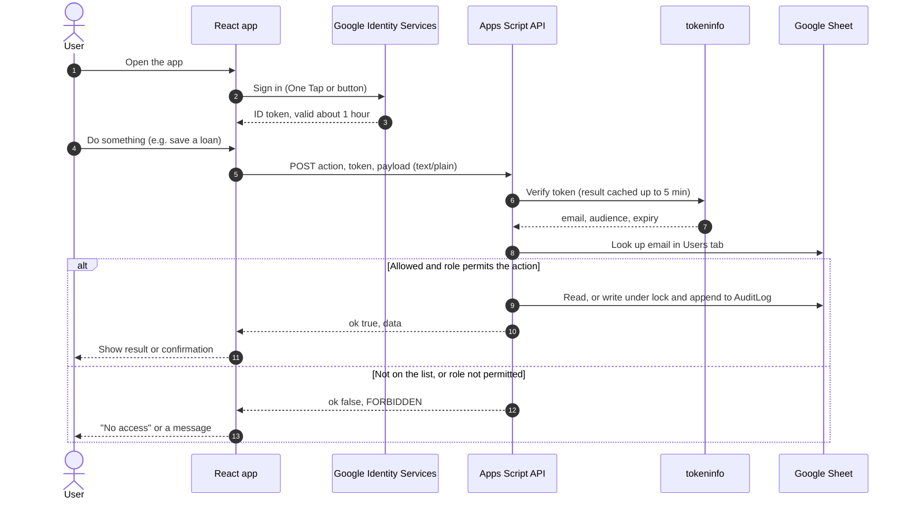

The body is sent as `text/plain` on purpose. A JSON content type would trigger a browser pre-check (CORS preflight) that Apps Script cannot answer. Apps Script always replies with HTTP 200, so the outcome lives in the `ok` field of the reply.

## 3. Checks on every request

The API trusts nothing from the browser except a token signed by Google. The checks run in this order and stop at the first failure.

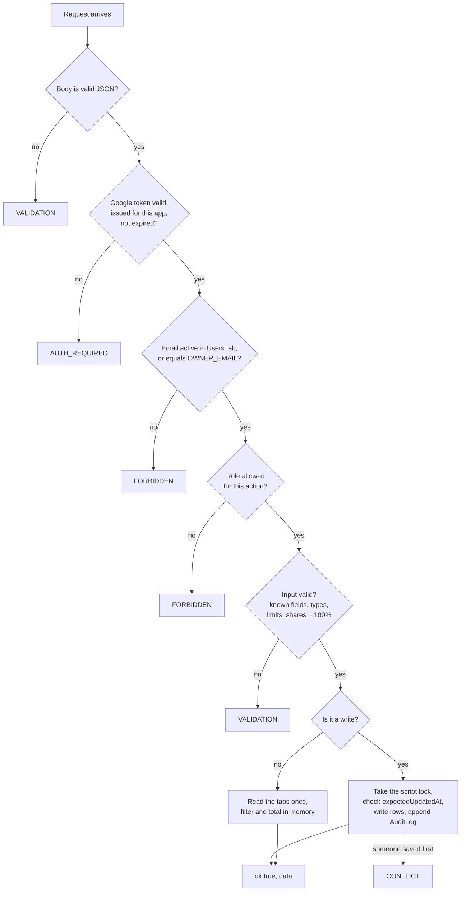

## 4. Sign-in and session states

The frontend's `AuthProvider` (`src/auth/AuthProvider.tsx`) moves between these states. The `expired` state keeps the screen mounted, so nothing typed is lost while the user signs in again.

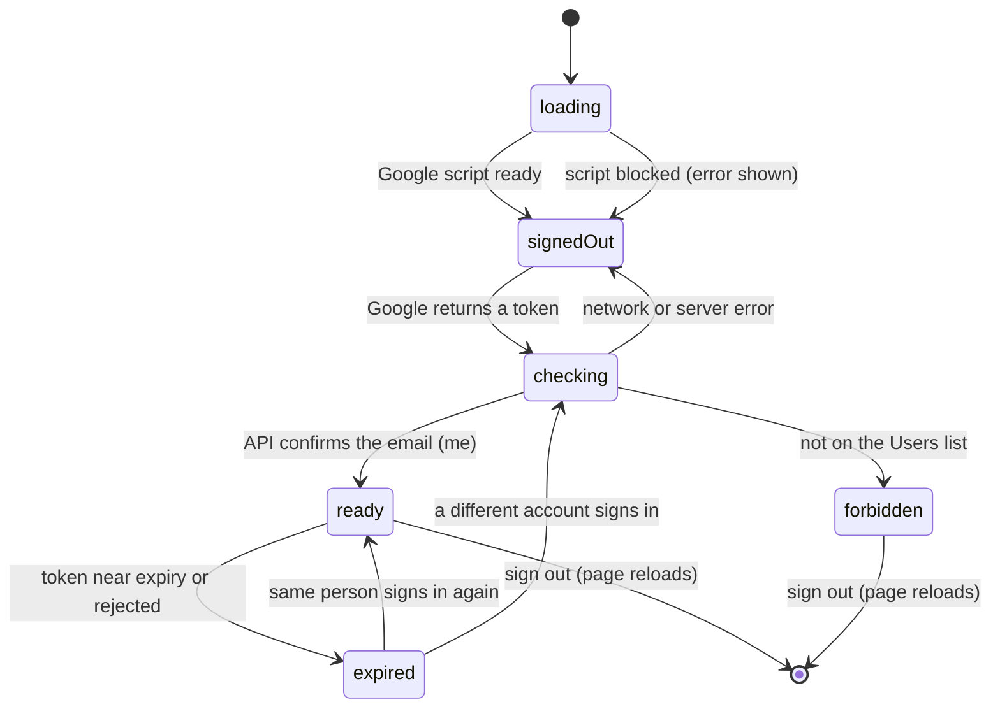

## 5. Roles

Roles live in the Users tab. `OWNER_EMAIL` is always an admin, so the app can never be left without one.

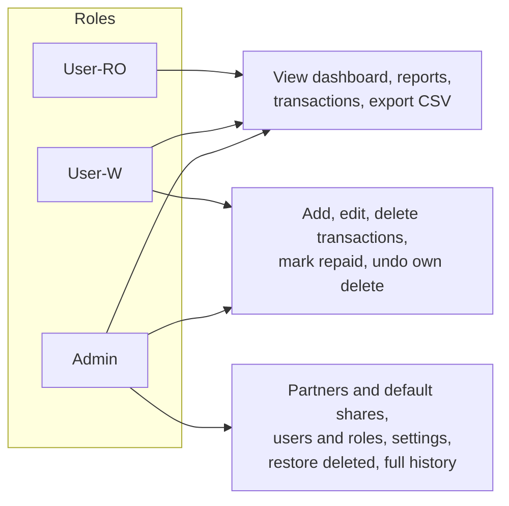

The server enforces the permission table in the API router. The frontend uses the same table only to hide buttons a role cannot use.

## 6. Data model

One tab per entity, one row per record, headers in row 1. Columns are found by header name, and all cells are stored as plain text.

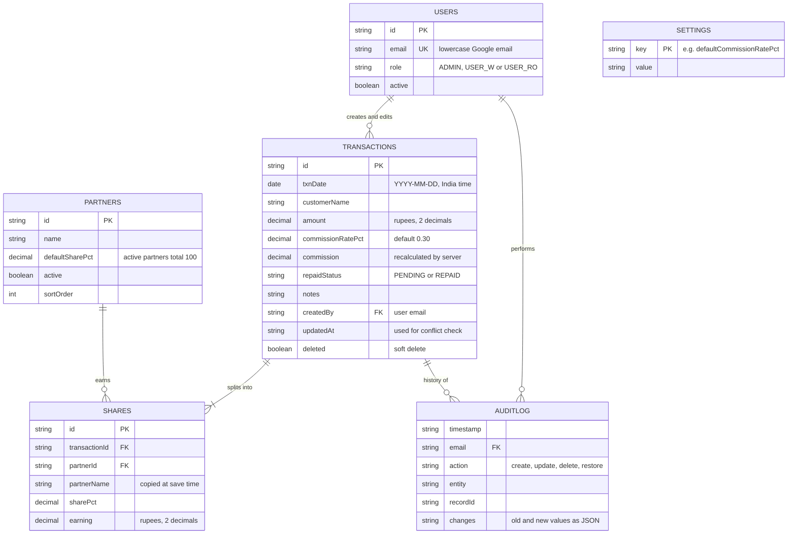

Users, Partners, Transactions and Shares also carry the system columns `createdAt`, `createdBy`, `updatedAt`, `updatedBy`, `deleted`, `deletedAt` and `deletedBy`. Shares copy the partner's name and percentage at save time, so later changes to partners never alter past reports.

## 7. Saving a transaction

The form shows live figures, but the server recalculates and saves its own. Both sides are tested against the same cases in `shared/calc-cases.json`.

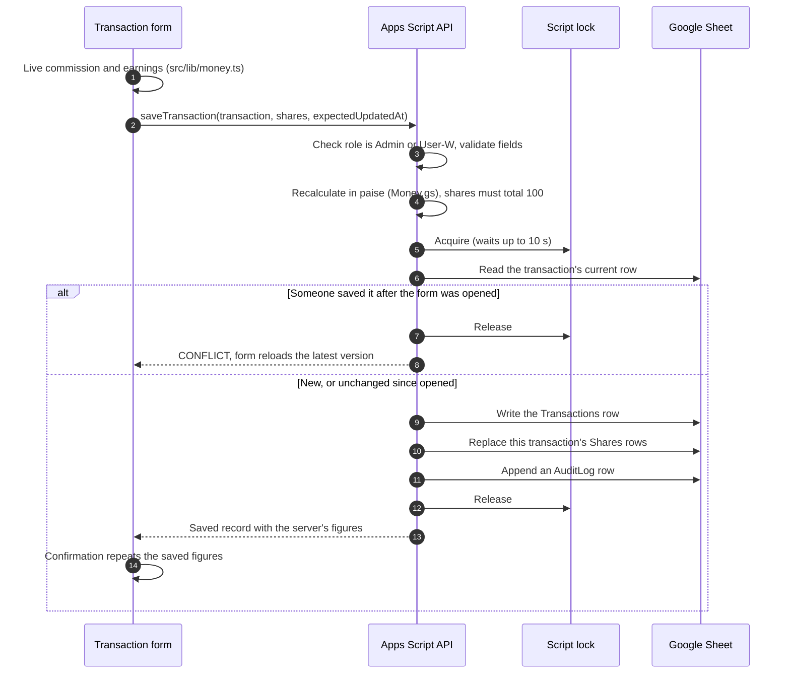

Money rules: amounts are calculated as whole paise. Commission = round(amount × rate ÷ 100). Each earning = commission × share ÷ 100, rounded down, and the last partner takes the leftover paisa, so the earnings always add up exactly to the commission.

## 8. Transaction lifecycle

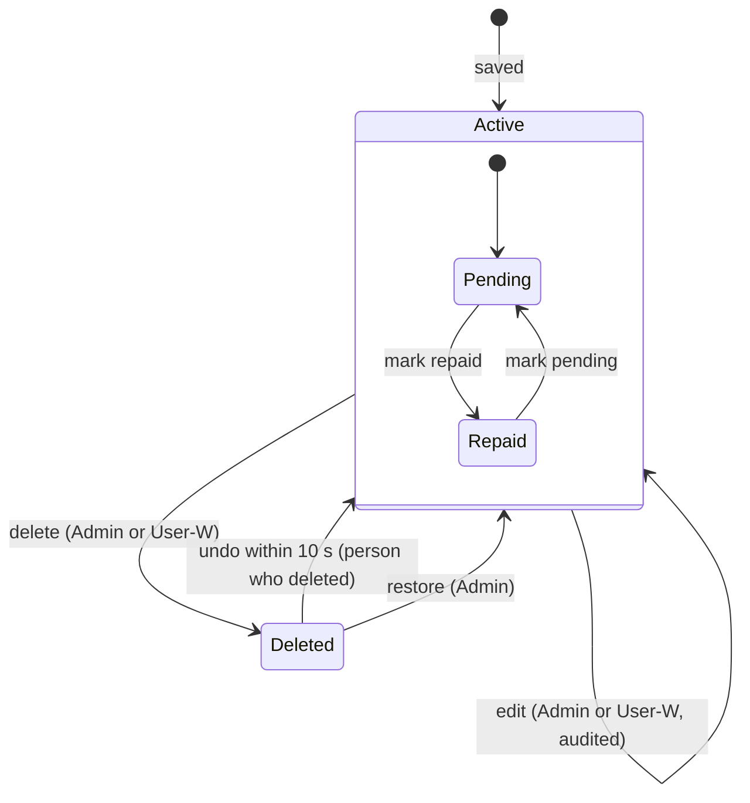

Nothing is ever removed from the Sheet. A deleted transaction is hidden from lists and totals, keeps who deleted it and when, and can be brought back.

## 9. Frontend structure

Dependencies point downwards only: pages use components and hooks, and only `ApiClient` talks to the network.

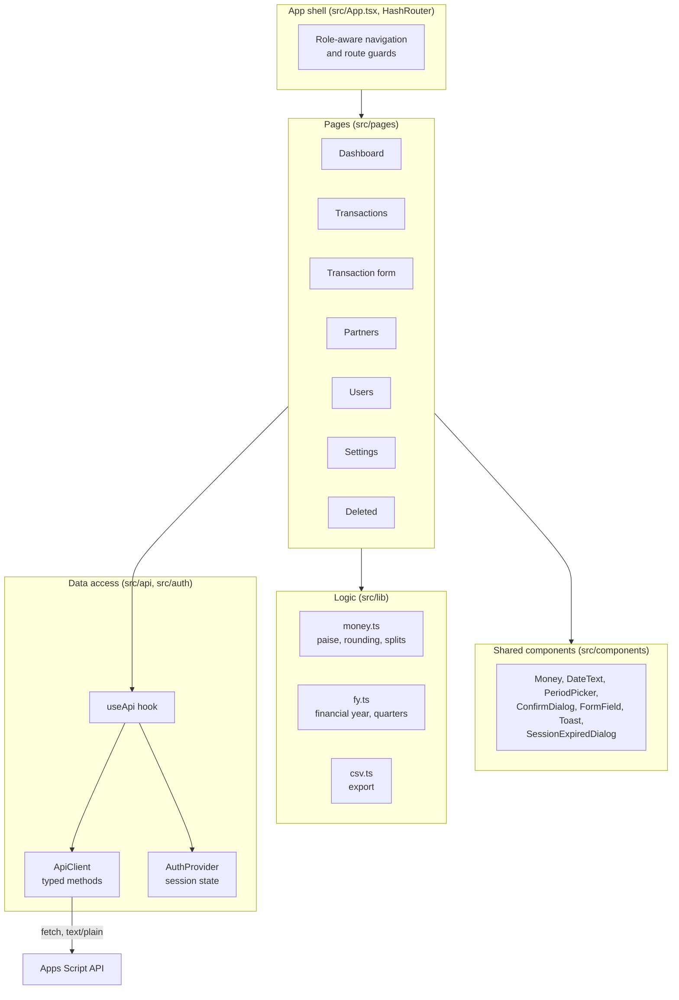

## 10. Backend structure

The Apps Script files share one global scope, but each file has one job, and only `Sheet.gs` touches the spreadsheet.

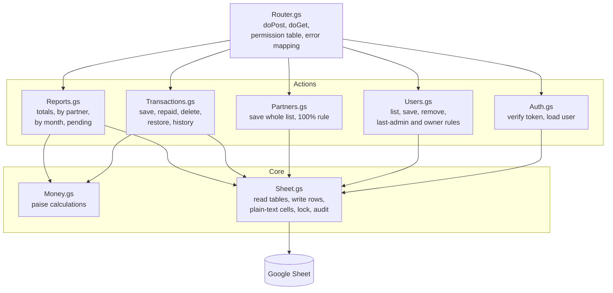

## 11. Build and deployment

The frontend deploys on every push to `main`. The backend deploys by hand as a new version of the same deployment, so its `/exec` URL never changes.

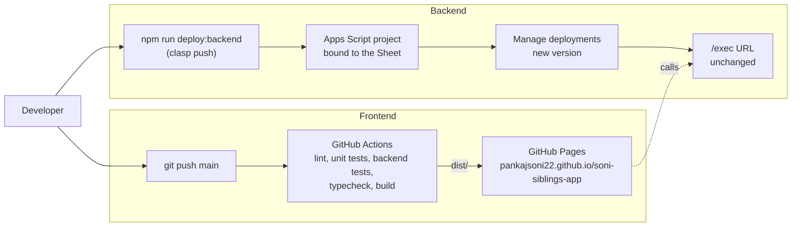

What still has to change from today's scaffold:

| Today | Target |
| --- | --- |
| One `Code.gs`, pasted into the editor | Separate `.gs` files, pushed with clasp |
| `ALLOWED_EMAILS` / `ADMIN_EMAILS` Script Properties, `isAdmin` flag | Users tab with three roles, plus `OWNER_EMAIL` |
| Generic `list/get/create/update/delete/restore` on a sample `Items` tab | Dedicated actions for transactions, partners, users, reports and settings |
| Google sign-in in Testing mode with test users | Production mode; the Users tab is the gate |
| Home page placeholder | Dashboard, Transactions, form, and admin screens |

## 12. Security layers

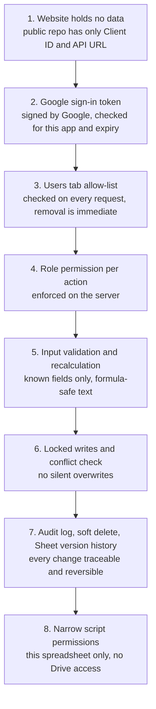

## 13. Key design decisions

| Decision | Why |
| --- | --- |
| Google Sheet as the database | Required; free; the owner can inspect and back it up. Sized for a few users and thousands of rows. |
| One API in front of the Sheet | Users never get Sheet access, so every rule is enforced in one place. |
| Server recalculates every figure | The screen's numbers are a preview; saved numbers can't be tampered with from the browser. |
| Integer paise for money | Avoids floating-point rounding errors in totals. |
| Shares copied onto each transaction | Changing partners or default shares never rewrites past reports. |
| Soft delete plus audit log | Nothing is lost; every change shows who and when. |
| `updatedAt` conflict check | Two people editing the same entry can't overwrite each other silently. |
| Plain-text cells and a formula escape | Sheets never turns IDs or dates into other types and never runs typed text as a formula. |
| `HashRouter` | GitHub Pages can't serve deep links like `/transactions/42`. |
| Token in the request body, `text/plain` | Keeps tokens out of URLs and logs; avoids a CORS pre-check Apps Script can't answer. |
