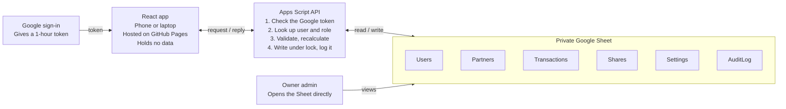

# Lending Commission Tracker: Requirements

Nov 14, 2026 · Pankaj Soni

> Exported from the [shared requirements document](https://claude.ai/artifact/JqoVErbDpm7nxrsTzdQaU3). Based on [initial-requirements.md](initial-requirements.md).

## Summary

The app records every short-term loan the business makes, works out the commission and each partner's cut as the entry is typed, and shows totals for any period. The business lends money for a few hours (for example 2 or 6 hours) and charges a fixed percentage commission, which is divided among the partners.

The app must let the partners:

- See, for any month, quarter or custom range, how much was lent and how much commission was earned.
- See how much each partner earned in that period.
- Record new loans quickly, on a phone, several times a day.
- Trust the numbers: every entry, change and deletion shows who did it and when.

Only people the admin has added can sign in. The data lives in a private Google Sheet that only the owner admin can open directly.

## Key terms

| Term | Meaning |
| --- | --- |
| Transaction | One loan to one customer on one date. Several can be made on the same day. |
| Amount lent | The money given to the customer, in ₹. |
| Commission rate | The percentage charged on the amount lent. Defaults to 0.30%. It does not depend on how many hours the loan lasts. |
| Commission | Amount lent × commission rate. This is what the business earns on the transaction. |
| Partner | A person who receives part of the commission. Partners are a list kept by the admin, separate from the people who log in. |
| Partner share | A partner's part of the commission, as a percentage of the commission. All shares on a transaction add up to 100%. |
| Partner earning | Commission × partner share, in ₹. |
| User | A person allowed to sign in, identified by their Google email. |
| Role | What a user may do: Admin, User-W (can write) or User-RO (read only). |
| Financial year (FY) | 1 April to 31 March. Quarters: Q1 Apr–Jun, Q2 Jul–Sep, Q3 Oct–Dec, Q4 Jan–Mar. |

The original requirement expressed a partner share as a rate (0.30% ÷ 3 partners = 0.10% each). This document states shares as a percentage of the commission (33.33% each) because it stays correct when the commission rate changes. The screen shows both: the percentage and the ₹ amount.

## Roles and permissions

There are three roles. Admin controls the app, User-W records and corrects transactions, and User-RO can only look.

| Action | Admin | User-W | User-RO |
| --- | --- | --- | --- |
| See the dashboard and reports for any period | Yes | Yes | Yes |
| See the list of transactions | Yes | Yes | Yes |
| Add transactions | Yes | Yes | No |
| Edit or delete any transaction | Yes | Yes | No |
| Mark a transaction repaid | Yes | Yes | No |
| Undo their own delete (within 10 seconds) | Yes | Yes | No |
| See deleted transactions and restore them | Yes | No | No |
| See the full change history of a transaction | Yes | No | No |
| Add, edit or deactivate partners and set default shares | Yes | No | No |
| Add or remove users and change roles | Yes | No | No |
| Change the default commission rate | Yes | No | No |
| Open the backend Google Sheet | Owner admin only | No | No |

Rules:

- There must always be at least one admin. The app refuses to remove or demote the last admin.
- The owner admin (the Google account that owns the Sheet) is always an admin and cannot be removed in the app.
- A role change applies to that person's next action. They do not need to sign out.
- Every permission is checked by the server on every request. Hiding a button on screen is only for convenience.

## Partners and default shares

The admin keeps the list of partners and each partner's default share; every new transaction starts from those defaults.

- Each partner has a name, a default share (% of commission) and a status: active or inactive.
- The default shares of all active partners must add up to exactly 100%. The Partners screen will not save otherwise and shows the running total.
- A partner does not need a login, and a user does not need to be a partner.
- A partner who leaves is deactivated, not deleted. They disappear from new transactions but stay on past ones and in past reports.
- Changing default shares affects only transactions entered after the change. Past transactions keep the shares they were saved with, so past reports never change on their own.
- Every change to partners and default shares is logged with who made it and when.

## Recording a transaction

An Admin or User-W fills one short form per loan; the commission and every partner's earning update on screen with each keystroke.

| Field | Required | Default | Rules |
| --- | --- | --- | --- |
| Transaction date | Yes | Today (India time) | Can be changed to a past date. Future dates are not allowed. |
| Customer name | Yes | Empty | Up to 100 characters. Suggests names already used before, to keep spelling consistent. |
| Amount lent (₹) | Yes | Empty | More than ₹0, up to 2 decimal places. |
| Commission rate (%) | Yes | 0.30% (set by admin) | More than 0% and less than 100%. |
| Commission (₹) | Calculated | — | Amount lent × commission rate. Shown live, not typed. |
| Partner shares (%) | Yes | Admin's default shares | One line per active partner, each with their ₹ earning beside their name. Must add up to 100%. |
| Repaid status | Yes | Pending | Pending or Repaid. Can be switched later from the transaction list with one tap. |
| Notes | No | Empty | Up to 500 characters. |

The app also records, without anyone typing it: who created the entry and when, and who last changed it and when.

### Partner shares on the form

- Each active partner is listed by name with two figures: their share (%) and their earning (₹).
- Changing one partner's share updates their ₹ at once. A total line shows the sum and turns red, with the gap (for example “95% — 5% left”), until it reaches 100%.
- Two buttons help: **Reset to defaults** and **Split equally**.
- Save stays disabled until the shares total exactly 100%.

### Worked example

Amount lent ₹5,00,000 at 0.30% gives a commission of ₹1,500, split with the default shares:

| Partner | Share | Earning |
| --- | --- | --- |
| Partner A | 40% | ₹600.00 |
| Partner B | 30% | ₹450.00 |
| Partner C | 30% | ₹450.00 |
| **Total** | **100%** | **₹1,500.00** |

Rounding: amounts are kept to the paisa. When a split does not divide evenly, the last partner in the list takes the leftover paisa, so the earnings always add up exactly to the commission.

### Saving

- **Save** returns to the list. **Save and add another** keeps the date and clears the rest, for entering several loans in a row.
- The server recalculates the commission and earnings itself before saving. It never trusts figures sent from the screen.
- The confirmation appears only after the Sheet has accepted the write, and repeats what was saved, for example “Saved: ₹5,00,000 to Ramesh Kumar, commission ₹1,500”.

## Editing, deleting and history

An Admin or User-W can edit or delete any transaction, and nothing is ever lost: every change is logged and every deletion can be reversed.

- **Edit:** opens the same form, pre-filled. Shares are shown as they were saved, not the current defaults.
- **Delete:** asks for confirmation first. The transaction is hidden from lists and reports but stays in the Sheet, marked with who deleted it and when.
- **Undo:** after a delete, an Undo button shows for 10 seconds to the person who deleted it.
- **Restore:** after that, only an admin can bring a deleted transaction back, from a “Deleted” view.
- **History:** each change is logged with who, when, and the old and new values. Every user sees who created and who last changed a transaction; admins also see its full history.
- **Two people editing at once:** if someone else saved the same transaction after you opened it, your save is stopped. The app shows the latest version and asks you to reapply your change, so no one silently overwrites another person's work.
- **Sheet history:** as a last resort, the owner admin can restore the whole Sheet to an earlier version using Google Sheets' version history.

## Reports and time ranges

The home screen is a dashboard for a chosen period, opening on the current month; everyone who can sign in sees it.

**Period picker.** Presets plus a custom range, all by transaction date in India time:

- Today, This month, Last month
- This quarter, Last quarter (financial-year quarters, e.g. Q3 FY 2026-27 = Oct–Dec 2026)
- This financial year, Last financial year (e.g. FY 2026-27 = 1 Apr 2026 – 31 Mar 2027)
- Custom: any from-date and to-date

**Figures for the chosen period:**

| Figure | Meaning |
| --- | --- |
| Total lent | Sum of amounts lent. |
| Total commission | Sum of commissions earned. |
| Transactions | Number of transactions. |
| Average rate | Total commission ÷ total lent. |
| Pending repayment | Amount lent on transactions still marked Pending, with their count. |
| Earnings by partner | Each partner's total earning, including inactive partners who earned in the period. |
| Month by month | Total lent and commission per month, when the period covers more than one month. |

**Transaction list for the period:** newest first, with search by customer name and a filter for Pending or Repaid. Deleted transactions never count in any figure.

## Users and access

The admin manages who can sign in entirely inside the app, on a Users screen; no Google console steps are needed per person.

- **Add a person:** enter their Google email and pick a role. They can sign in straight away.
- **Change a role:** pick Admin, User-W or User-RO. Applies on their next action.
- **Remove a person:** their access ends on their next action, even if the app is open on their phone.
- **Anyone not on the list** who signs in with Google sees “Your account doesn't have access” and nothing else.
- **First admin:** the owner's email is set once during setup. That account is always an admin, so the app can never end up with no admin.

What this means for setup: the Google sign-in app is switched from “Testing” to “Production” once. Basic Google sign-in needs no review by Google. Anyone with a Google account can then reach the sign-in step, and the app's own list decides who gets in. There is no 100-person limit.

## Security and privacy

Only listed people can read or change data, and only through the app; the backend Sheet is private to the owner admin.

**The backend Sheet:**

- It is owned by the owner admin's Google account and shared with nobody. Users never need access to it; the app reads and writes on the owner's behalf.
- If other admins should also see the Sheet, the owner shares it with them as **view only**, by hand. The app cannot share it automatically, because it is deliberately given no access to Google Drive. View only stops anyone from bypassing the app's checks by typing into the Sheet.

**How each risk is stopped:**

| Risk | What stops it |
| --- | --- |
| A stranger opens the website | They see only the sign-in button. No data is in the page or its code. |
| A stranger signs in with Google | Not on the Users list, so every request is refused. |
| Someone calls the backend directly | Refused without a valid Google sign-in token issued for this app. |
| A User-RO tries to add or change data | The server checks the role on every request and refuses. |
| A removed person keeps the app open | The list is checked on every request; access ends immediately. |
| A wrong or malicious edit or delete | Every change is logged, deletes are reversible, the Sheet has version history. |
| Harmful text typed into a field | Inputs are checked by type and length; text is stored so it can never run as a Sheet formula or as code on screen. |
| The owner's Google or GitHub account is taken over | 2-Step Verification must be on for both. |

**Privacy:** customer names and amounts are personal and financial data. They are never put in web addresses or logs, and the website code holds no data, only the public sign-in settings.

## User experience

The app must feel quick and certain on a phone: the user always knows whether their entry was saved.

| Area | Requirement |
| --- | --- |
| Phone first | Every screen works one-handed at phone width. Amount and rate fields open the number keypad. Works equally on a laptop. |
| Live figures | Commission and partner earnings update as each digit is typed, with no button press. |
| Save confirmation | A success message appears only after the Sheet has stored the entry, and repeats the key figures saved. |
| Errors | Shown in plain words next to the field to fix, e.g. “Shares add up to 95%, need 100%”. A failed save keeps everything typed and offers Retry. |
| Waiting | Each save or load takes about 1–3 seconds (a limit of the Google backend). A progress indicator shows, and the Save button is disabled so an entry cannot be saved twice. |
| Fast browsing | Changing the period, searching or filtering the list happens instantly on screen once data is loaded. |
| Session expiry | Google sign-in lasts about 1 hour. When it runs out, a “Sign in again” dialog appears over the screen, and nothing typed is lost. |
| Number and date format | ₹ with Indian grouping (₹1,25,000.00). Dates as 14 Nov 2026. All times in India time. |
| Look | Clean and consistent, light and dark themes, readable contrast, usable with a keyboard. |
| Read-only users | User-RO never sees add, edit or delete buttons, rather than seeing them fail. |

## Technical design (for the developer)

The app keeps the stack already set up in the repo: a React + TypeScript site on GitHub Pages, an Apps Script API, and one private Google Sheet as the database. The sections below define what changes for this business.

The browser never touches the Sheet: every read and write goes through the API, which checks sign-in, the Users list and the role first.

### Sheet tabs

Every tab except Settings and AuditLog also has the system columns: `id`, `createdAt`, `createdBy`, `updatedAt`, `updatedBy`, `deleted`, `deletedAt`, `deletedBy`.

| Tab | One row per | Columns |
| --- | --- | --- |
| Users | person allowed in | `email`, `role` (ADMIN, USER_W, USER_RO), `active` |
| Partners | partner | `name`, `defaultSharePct`, `active`, `sortOrder` |
| Transactions | loan | `txnDate` (YYYY-MM-DD), `customerName`, `amount`, `commissionRatePct`, `commission`, `repaidStatus` (PENDING, REPAID), `notes` |
| Shares | partner on a transaction | `transactionId`, `partnerId`, `partnerName` (copied at save time), `sharePct`, `earning` |
| Settings | setting | `key`, `value` (e.g. `defaultCommissionRatePct` = 0.30) |
| AuditLog | change | `timestamp`, `email`, `action`, `entity`, `recordId`, `changes` (old and new values as JSON) |

Shares sit in their own tab so the owner admin can read and pivot partner earnings directly in the Sheet.

### API actions

| Action | Allowed roles | Behaviour |
| --- | --- | --- |
| `me` | All | Email, name and role of the caller. |
| `getConfig` | All | Active partners with default shares, default commission rate. |
| `listTransactions` {from, to} | All | Transactions in the range with their shares. Deleted ones only for Admin. |
| `report` {from, to} | All | Totals, earnings by partner, month-by-month figures. |
| `saveTransaction` | Admin, User-W | Create or update a transaction and its shares in one locked write. Recalculates every figure on the server. Update requires `expectedUpdatedAt`. |
| `setRepaid` | Admin, User-W | Switch Pending/Repaid. |
| `deleteTransaction` | Admin, User-W | Soft delete. |
| `restoreTransaction` | Admin; or the deleter within 10 s | Undo or restore a deleted transaction. |
| `getHistory` {id} | Admin | Audit entries for one transaction. |
| `savePartners` | Admin | Saves the whole partner list at once, so the 100% rule is checked in one step. |
| `listUsers`, `saveUser`, `removeUser` | Admin | Refuses to remove or demote the last admin or the owner. |
| `saveSettings` | Admin | Default commission rate. |

### Calculation rules

- Money is calculated in whole paise (integers) to avoid rounding errors, and stored in ₹ with 2 decimals.
- Commission = round(amount × rate ÷ 100) to the paisa.
- Each earning = commission × share ÷ 100, rounded down to the paisa; the last partner gets the remainder, so earnings sum exactly to the commission.
- Shares are stored with 2 decimals and must total exactly 100.00.
- Dates are calendar dates in India time; the financial year and quarter are derived from `txnDate` (FY starts 1 April).

### Changes to the current scaffold

- Replace the `ALLOWED_EMAILS` and `ADMIN_EMAILS` Script Properties with the Users tab, plus one `OWNER_EMAIL` property for the permanent admin.
- Replace the single `isAdmin` flag with the three roles, checked per action as in the table above.
- Add the dedicated transaction actions; the generic CRUD stays for simple lists.
- Switch the Google sign-in app to Production.
- Mirror the new types in `src/api/types.ts` and add matching `ApiClient` methods.
- Screens: Dashboard, Transactions, Transaction form, Partners, Users, Settings.

## Decisions and open questions

**Decided:**

| Topic | Decision |
| --- | --- |
| Roles | Three: Admin, User-W, User-RO. At least one admin always; the owner is a permanent admin. |
| Partner shares | Admin sets each partner's default share; each transaction starts from them, can be changed, and must total 100% of the commission. |
| Partners vs users | Separate lists. A partner needs no login. |
| Access | Managed only in the app's Users screen. Google sign-in switched to Production. |
| Edit rights | Admin and User-W can edit or delete any transaction; all changes logged. |
| Extra fields | Repaid status (Pending/Repaid) and Notes. |
| Periods | Indian financial year, April to March. |
| Currency | ₹ with Indian digit grouping. |

**Open, with a proposed answer (tick when agreed):**

- [ ] Does commission count as earned before the loan is repaid? Proposed: yes, by transaction date; Pending amounts are shown separately.
- [ ] Can User-RO see customer names and individual transactions, or only totals? Proposed: they see everything, read only.
- [ ] Should a commission rate above a set level (for example 2%) ask “Are you sure?” to catch typing mistakes? Proposed: yes, warn above 2%.
- [ ] Should partners who log in see only their own earnings? Proposed: no, everyone sees all partners.
- [ ] Is an export to Excel/CSV of the selected period needed? Proposed: later, not in the first version.
- [ ] Should a customer's phone number be recorded, to tell apart customers with the same name? Proposed: not in the first version.
